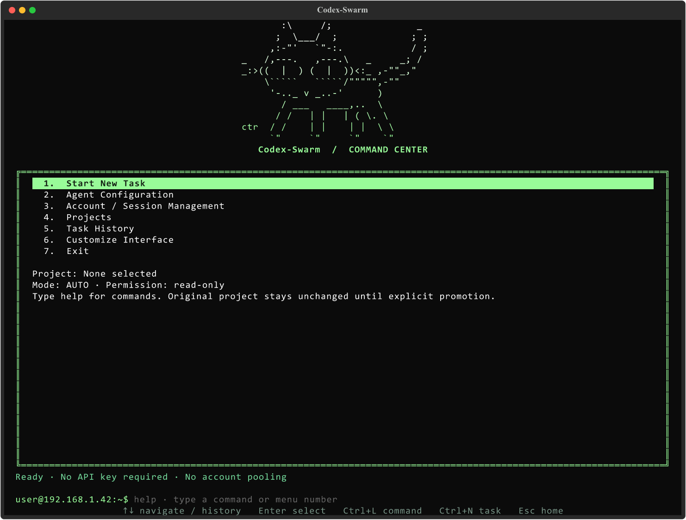

<div align="center">

# Codex-Swarm

**One task. Multiple agents. One terminal.**

A terminal command center for parallel Codex development with ChatGPT sign-in,
isolated Git worktrees, and a review-first workflow.


</div>



> **free-codex-swarm** is the repository name; **Codex-Swarm** is the application name.
> The software is free and open source. Codex access, model availability, and usage
> allowances depend on your account. This project does not provide trials, unlimited
> usage, or automatic account rotation. It is an independent project, not an OpenAI product.

## Why use it?

- **Parallel workers:** a coordinator breaks your objective into focused assignments.
- **Isolated edits:** workers use separate Git worktrees; your original checkout stays unchanged until promotion.
- **Review before merge:** integration is serialized, followed by a final review and explicit confirmation.
- **Real visibility:** live agent states, event logs, token telemetry when available, and saved reports.
- **Flexible sessions:** one ChatGPT login with multiple process slots, or independently configured credential homes.
- **Make it yours:** 16 themes, editable ASCII art, gradients, centered headings, and the default cat.
- **No API key required:** this app uses official Codex CLI with ChatGPT authentication.

```text
objective -> coordinator plan -> parallel workers -> integration -> review -> your approval
```

## Requirements

| Requirement | Details |
| --- | --- |
| Windows | Windows 10/11 is the target platform; Windows is locally tested. |
| Python | Python 3.11 or newer, with pip and venv. Python 3.13 was used for local verification. |
| Git | Installed and available on PATH. Projects need an initial commit and a clean working tree. |
| Codex CLI | A recent official native CLI supporting `exec`, `app-server`, and the flags used by this release. |
| ChatGPT sign-in | An account with working Codex access. No particular free/trial entitlement is promised. |
| Internet | Needed to install dependencies, sign in, and run Codex. |
| Project tools | Install your project's language runtimes/test tools separately. |

[Download Python](https://www.python.org/downloads/windows/) ·
[Download Git](https://git-scm.com/downloads/win) ·
[Official Codex installation guide](https://learn.chatgpt.com/docs/codex/cli)

The Python installer should include the launcher or add Python to PATH. Reopen your
terminal after installing prerequisites. Administrator access is not required by the
app's installer. macOS/Linux execution is not verified; see [LIMITATIONS.md](LIMITATIONS.md).

## Quick start on Windows

### 1. Download the repository

On GitHub select **Code -> Download ZIP**, extract it, and open the extracted folder.
Keep all the files together. You do not need to know the repository owner's username.

Or clone the URL from the repository's **Code** button and open the cloned folder.

### 2. Install the Python requirements

Double-click **`install_requirements.bat`**.

Or run from PowerShell in the repository folder:

```powershell
.\install_requirements.bat
```

The installer creates a local `.venv`, installs this project and its dependencies
from `requirements.txt` / `pyproject.toml`, then runs `pip check`. It does not install
Codex, sign you in, change PowerShell execution policy, or modify account credentials.
Run it again after updating the source. It is safe to reuse an existing compatible venv.

**Manual alternative:**

```powershell
py -3 -m venv .venv
& .\.venv\Scripts\python.exe -m pip install -r requirements.txt
```

If the `py` launcher is unavailable, use `python` instead of `py -3`.

### 3. Install Codex and sign in

Follow the [official CLI installation guide](https://learn.chatgpt.com/docs/codex/cli).
If you already have Codex installed, check its version rather than reinstalling it.

```powershell
codex --version
codex login
codex login status
```

Choose **Sign in with ChatGPT** in the browser flow. This app rejects API-key-only
logins. The CLI owns authentication; never paste passwords or tokens into the app.
[Official authentication documentation](https://learn.chatgpt.com/docs/auth).

If PowerShell blocks an npm-installed `codex.ps1` wrapper, use `codex.cmd` for these
commands instead. Follow the official installer instructions if Codex is not on PATH.

### 4. Launch

Double-click **`run.bat`**, or run:

```powershell
.\run.bat
```

Direct Python also works without enabling PowerShell scripts:

```powershell
& .\.venv\Scripts\python.exe .\main.py
```

**Check installation/authentication without an inference call:**

```powershell
.\run.bat --doctor
```

The doctor prints the selected native CLI, login status, and model catalog. This
release was live-tested with CLI `0.162.0-alpha.2`; older CLI versions can reject
new model catalogs or required flags. If discovery is wrong, set `codex_binary`
to your native `codex.exe` in **Agent Configuration**.

## Run your first task

1. Select **Projects** and add a Git repository that has at least one commit.
   Commit or stash your changes yourself first; the app refuses dirty projects.
2. Open **Agent Configuration**. Choose mode, concurrency, and invocation budget.
   **Read-only is the default.** For code changes, explicitly set `permission`
   to `workspace-write` and Apply.
3. Run `models` to inspect access and supported reasoning options for your login.
4. Select **Start New Task**, describe the objective, and Apply.
5. Watch the worker dashboard and inspect the report after the final review.
6. If the result is `ready`, run `promote <task-id>` and confirm with `PROMOTE`.
   Promotion is never automatic.

Example objective:

```text
Fix the failing arithmetic tests. Keep public function signatures unchanged,
limit changes to the arithmetic modules, and run the existing tests.
```

Windows sandbox defaults to `elevated`. If official sandbox setup fails, fix it
using the CLI's guidance. A supported `unelevated` fallback can be selected
explicitly in Agent Configuration, but has weaker isolation. There is no silent
fallback or automatic elevation. [Windows sandbox guide](https://learn.chatgpt.com/docs/windows/windows-sandbox).

## Accounts and process slots

The default is **one coordinator + three worker slots**. Blank `codex_home` values
share your current CLI login and allowance; more slots do not create new accounts.

To use an independently authenticated session:

1. Open **Account / Session Management -> Configure Worker Sessions**.
2. Give the profile a separate absolute `codex_home` directory.
3. Run `login session_02` (replace the ID with your profile's ID) and complete
   the official browser flow.

Use accounts you are authorized to access. The tool does not create accounts,
automatically rotate identities, pool quotas, or guarantee free/trial access.
Independent-account flows are implemented but were not live-tested with multiple
accounts. See the [full session guide](docs/USAGE.md#sessions-are-not-pooled-accounts).

## Commands and shortcuts

| Command | Purpose |
| --- | --- |
| `help`, `home` | Command reference / home menu |
| `new`, `projects` | New objective / select repository |
| `agents`, `status`, `logs [agent]` | Dashboard, status, and event logs |
| `models`, `accounts`, `slots <n>` | Catalog and session settings |
| `agent_config`, `settings` | Engine preferences / additional preferences |
| `theme`, `ascii`, `colors` | Interface customization |
| `save`, `back` | Save appearance / discard draft |
| `history`, `resume <id>`, `retry <id>` | Saved work and recovery |
| `review <id>`, `promote <id>` | Final review / confirmed integration |
| `stop <agent>`, `cancel`, `exit` | Stop a worker, cancel a task, or exit |
| `reset_settings` | Confirm a backed-up reset of all preferences |

**Arrow keys** navigate · **Enter** selects · **Ctrl+L** focuses the prompt ·
**Ctrl+N** starts a task · **Ctrl+Enter** applies the editor · **Esc** returns home.
Prompt **Up/Down** recall history and **Tab** completes commands. This is not an OS shell.

## Appearance and window sizing

Choose **Customize Interface** to preview/save any of the 16 palettes or import,
paste, and edit artwork. The default is the supplied cat; its signature is retained.

Classic PowerShell console windows request at least **120 columns x 44 rows** at
startup. Larger saved artwork raises the target, subject to display/font limits.
Windows Terminal and embedded terminals own their outer-window sizing. Artwork
remains scrollable if it cannot fit; `--no-resize` leaves the window unchanged.
[Detailed appearance guide](docs/USAGE.md#appearance).

## Troubleshooting

| Problem | What to do |
| --- | --- |
| Python not found | Install Python 3.11+, enable PATH/launcher, and reopen the terminal. |
| `Launch.ps1` is blocked | Use `run.bat` or direct Python; no execution-policy change is needed. |
| Missing Python module | Rerun `install_requirements.bat` and check its installation output. |
| Codex not found | Install the official CLI, reopen the terminal, or set native `codex_binary`. |
| API-key authentication rejected | Run `codex login` and choose ChatGPT sign-in. |
| Unknown model/effort or flag | Update the official CLI; run `--doctor` and `models`; do not hard-code unavailable models. |
| Dirty Git checkout | Review and commit/stash your changes yourself before starting. |
| Quota/model unavailable | Wait or adjust your authorized configuration; the app does not bypass limits. |
| Sandbox setup fails | Use official sandbox troubleshooting; fallback selection is manual. |
| Another instance owns state | Close the existing app; a stale lock filename alone does not mean the lock is held. |
| Artwork is partly hidden | Enlarge your terminal or scroll the artwork panel. |

State is outside the repository: `%LOCALAPPDATA%\CodexSwarm` by default. `--home`
and `CODEX_SWARM_HOME` select another location. A previous `%LOCALAPPDATA%\CodexNexus`
installation is reused for compatibility. A reset backs up preferences and leaves
Codex authentication, task records, and preserved worktrees alone.

## Development

```powershell
& .\.venv\Scripts\python.exe -m pip install -r requirements-dev.txt
& .\.venv\Scripts\python.exe -m pytest -q
& .\.venv\Scripts\python.exe -m ruff check codex_swarm scripts tests --select F
```

Normal tests use mocked provider calls and temporary local Git/process fixtures;
they do not sign in or consume Codex allowance. GitHub Actions runs the Windows
suite on Python 3.11 and 3.13. The live acceptance scripts are explicit opt-in and
consume your existing allowance; do not run them casually or in public CI.

[Contributing](CONTRIBUTING.md) · [Security](SECURITY.md) ·
[Verification](VERIFICATION.md) · [Limitations](LIMITATIONS.md) ·
[Detailed usage](docs/USAGE.md)

## License and credits

Original project code and documentation are released under the [MIT License](LICENSE).
Third-party dependencies keep their own licenses. The supplied cat carries the
signature `ctr`; see [third-party notices](THIRD_PARTY_NOTICES.md) for its provenance
and licensing status. OpenAI, ChatGPT, and Codex names belong to their respective owners.
